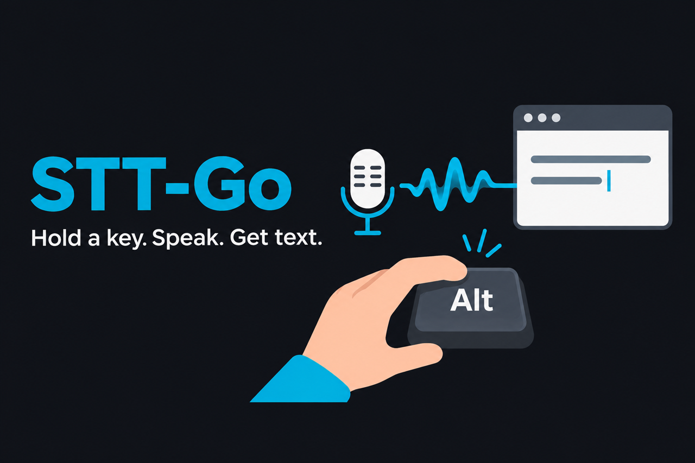
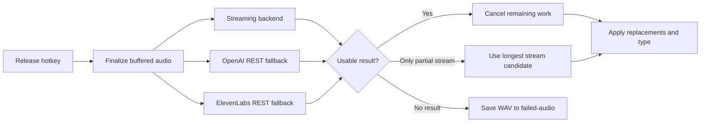

<div align="center">

# STT-Go

**The open-source Wispr Flow alternative. Hold a key, speak, get text in any app.**

[](https://github.com/Msparihar/stt-go/actions/workflows/ci.yml)
[](https://github.com/Msparihar/stt-go/releases)
[](LICENSE)
[](#quickstart)



</div>

STT-Go is a single Go application that lives in the system tray. It records 16 kHz mono audio, sends it to the backend you select, applies your replacement rules, and types the result into the window that was focused when recording began. Cloud backends use your own API keys; local Whisper and Granite run through a sidecar on your machine.

## vs Wispr Flow

| | STT-Go | Wispr Flow |
|---|---|---|
| Price | Free, MIT-licensed, open source | Subscription |
| Offline | Yes: local Whisper `large-v3-turbo` (MLX on Apple Silicon, ~220 ms per utterance; CUDA on NVIDIA) | No, cloud only |
| Cloud engines | Bring your own key: Deepgram Nova-3, ElevenLabs Scribe, OpenAI, Groq Whisper | Their models |
| Your audio | Stays on your disk; goes only to the engines you configure | Their servers |
| AI auto-editing / tone polish | No, you get what you said | Yes |

If you want an assistant that rewrites your speech, Wispr Flow does more. If you want fast, private dictation you control and can read the source of, this is it.

## Features

| Dictation | Transcription | Recovery |
|---|---|---|
| Hold-to-talk on Windows and macOS; tap-to-toggle on macOS | Ten tray-selectable cloud, streaming, and local backend modes | Streaming race mode, retries, and saved audio when every candidate fails |
| Types into editors, browsers, terminals, and chat apps | Deepgram, ElevenLabs, OpenAI, Groq, local Whisper, and local Granite | Repetition-wall transcripts are suppressed instead of typed |
| Select the microphone and backend from the tray | Keyterm hints and case-insensitive replacement rules | Every accepted take is retained in `debug-audio/` for seven days |

## How it works

Deepgram and ElevenLabs streaming use the race path below. Their streaming result and every configured REST fallback begin together. A clean streaming result can win inside the two-second decision window; otherwise the first usable REST result wins. A partial streaming result remains a last resort, and a total failure saves the WAV for recovery.



Other selected backends run directly with the same buffered audio and retry policy. Recordings shorter than 0.3 seconds are ignored.

## Quickstart

### Windows

Download `stt-go_<version>_windows_amd64.zip` from [Releases](https://github.com/Msparihar/stt-go/releases), unzip it, and run `stt-go.exe`. Windows uses **Right Alt** for push-to-talk. Unsigned builds may trigger SmartScreen; choose **More info → Run anyway** if you built or downloaded the binary from this repository.

Then run the setup wizard and choose a backend:

```powershell
.\stt-go.exe --setup
```

To build it yourself, install Go 1.25.7 and run:

```powershell
git clone https://github.com/Msparihar/stt-go.git
cd stt-go
go build -ldflags "-H windowsgui" -o stt-go.exe .
```

### macOS (Apple Silicon)

Build from source with Go 1.25.7 and the Xcode command line tools:

```bash
git clone https://github.com/Msparihar/stt-go.git
cd stt-go
go build -o stt-go .
./stt-go --setup
./stt-go
```

Grant the terminal or launcher **Input Monitoring** and **Accessibility** access under **System Settings → Privacy & Security**. macOS requests microphone access on the first recording. Relaunch the terminal after changing permissions. The default hotkey is **Control**.

API keys can be saved by the wizard, placed in the environment, or added to `~/.env.local`. Lookup order is `config.json` → environment → `~/.env.local`.

## Backends

Choose a backend from the tray or set `default_backend` in the configuration:

- Deepgram Nova-3 and ElevenLabs Scribe streaming
- ElevenLabs Scribe batch
- OpenAI REST, SSE streaming, live, and realtime modes
- Groq Whisper
- Local Whisper and Granite 4.1 through the Python sidecar

Race and comparison features can send audio to more than the selected cloud provider when the corresponding keys are configured. Use local Whisper without cloud keys if audio must remain on the machine.

## Local transcription

The Python sidecar in `sidecar/server.py` runs `large-v3-turbo` through MLX on Apple Silicon or faster-whisper on NVIDIA/CUDA. No API key is required.

```bash
cd sidecar
python3 -m venv .venv
.venv/bin/pip install -r requirements.txt
```

On Windows, use `.venv\Scripts\pip` for the final command. Select **Whisper Local (GPU)** or **Granite 4.1 Local** from the tray; STT-Go starts and manages the sidecar. The first Whisper use downloads a model of about 1.6 GB. The repository's recorded Apple Silicon run transcribed a 6.6-second sample with a 0.210-second warm pass; hardware and audio length will change that result.

## Configuration

`config.json` is created on first run. It lives in `~/Library/Application Support/STT-Go/` on macOS and next to the executable on Windows. See [`config.example.json`](config.example.json).

| Field | Purpose | Default |
|---|---|---|
| `default_backend` | Backend selected at startup | `deepgram` |
| `language` | Language code passed to the backend | `en` |
| `hotkey` | macOS modifier: `ctrl`, `option`, `cmd`, `shift`, `fn`, or a `left_`/`right_` variant; ignored on Windows | `ctrl` |
| `tap_toggle` | Let a bare hotkey tap start or stop recording on macOS | `true` |
| `mic_device` | Saved microphone name; empty uses the system default | empty |
| `keyterms` | Vocabulary hints for Deepgram and Whisper prompts | developer vocabulary list |
| `granite_keyterms` | Short vocabulary list for local Granite | empty |
| `replacements` | Case-insensitive `from → to` corrections applied before typing | bundled common corrections |
| `streaming_mode` | Type OpenAI realtime transcription while speaking | `false` |
| `realtime_model` | OpenAI realtime transcription model | `gpt-4o-mini-transcribe` |
| `groq_model` | Groq transcription model | `whisper-large-v3` |
| `local_whisper_url` | Local sidecar transcription endpoint | `http://127.0.0.1:5111/transcribe` |
| `local_whisper_python` | Python executable used for the sidecar | auto-detected |
| `local_whisper_script` | Sidecar server script | bundled `sidecar/server.py` |
| `api_keys` | `deepgram`, `openai`, `elevenlabs`, and `groq` credentials | empty |

One-run overrides are available through `--backend <name>`, `--language <code>`, and `--no-tray`.

## Troubleshooting

| Problem | Check |
|---|---|
| The hotkey does nothing | Look for `[KEY]` entries in `stt-go.log`. On macOS, re-check Input Monitoring after rebuilding the binary. |
| Recording works but text is not inserted | On macOS, grant Accessibility access to the terminal or launcher. Keep the destination window focused when recording starts. |
| An `auth_error` appears | Re-run `--setup` or verify the selected backend's key in `config.json`, the environment, or `~/.env.local`. |
| Local transcription does not start | Confirm the sidecar virtual environment is installed, then use **Restart local model** from the tray. |
| A cloud request fails | Check `[RACE]`, `[RETRY]`, and `[STT]` lines. Failed race audio is retained in `failed-audio/` for seven days. |

Logs are written to `stt-go.log` in the application data directory and rotate at 5 MB. Useful tags include `[KEY]`, `[REC]`, `[RACE]`, `[RETRY]`, `[STT]`, `[TYPE]`, and `[CFG]`.

## Roadmap and contributing

Roadmap work is tracked in [GitHub Issues](https://github.com/Msparihar/stt-go/issues). Bug reports and pull requests are welcome; read [CONTRIBUTING.md](CONTRIBUTING.md), [CODE_OF_CONDUCT.md](CODE_OF_CONDUCT.md), and [SECURITY.md](SECURITY.md) first.

## License

MIT — see [LICENSE](LICENSE).
